## 1. Introduction

> [!NOTE]
> This lab is based on [Spec-Driven ADK Agent Development with Antigravity and Spec-kit](https://codelabs.developers.google.com/sdd-adk-antigravity).

Adding features to an existing agent — a new database-backed capability — typically means writing boilerplate, wiring up integrations, and keeping everything consistent with the patterns already in the codebase. Antigravity accelerates every stage of this process: it analyzes your codebase to build the context it needs, produces structured specifications and implementation plans for your review, and executes the code changes — all guided by domain knowledge it helps you capture as reusable skills and a project constitution that enforces non-negotiable principles. This codelab introduce a way to supercharge Antigravity Spec-driven Development paradigm by introducing a new cycle to boost specification documentation heavily referencing  [spec-kit](https://github.com/github/spec-kit)

### What you'll build

A locally running restaurant concierge application with reservation booking added through a complete SDD cycle:

- **Reservation booking** — guests book tables and check reservations, backed by new MCP Toolbox database tools and a Cloud SQL `reservations` table
- **(Challenge) –** develop your own UI for the agent
- **(Challenge) –** deploy to Google Cloud with the help of the Antigravity agent

The starter code provides a working ADK agent with menu search (keyword + semantic via MCP Toolbox) and dietary preference tracking (via ToolContext). You extend it without writing application code by hand — Antigravity handles the implementation based on your specifications.

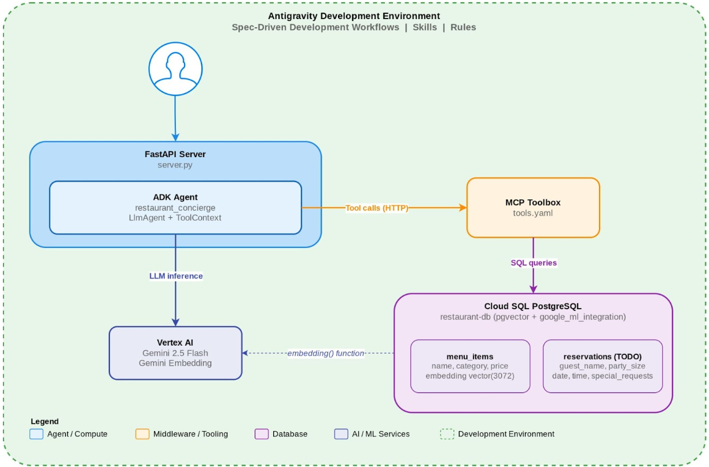

### What you'll learn

- How to bootstrap project context so Antigravity understands an existing codebase
- How to create Antigravity skills and configure MCP that package domain knowledge (e.g., ADK docs, 3rd party skills) for reuse
- How to set a project constitution that the SDD workflows validate against during planning and analysis
- How to use Spec-Driven Development (SDD) workflows in Antigravity to systematically add features
- How to extend an ADK agent with new database-backed tools via MCP Toolbox

### Prerequisites

- [Google Antigravity](https://antigravity.google) and `git` installed on your local machine
- A Google Cloud account with a active billing account enabled
- Previous completion of the four prerequisite ADK codelabs (or equivalent knowledge) will be helpful to understand use case context:
- [Building AI Agents with ADK: The Foundation](https://codelabs.developers.google.com/devsite/codelabs/build-agents-with-adk-foundation)
- [Building AI Agents with ADK: Empowering with Tools](https://codelabs.developers.google.com/devsite/codelabs/build-agents-with-adk-empowering-with-tools)
- [Building Persistent AI Agents with ADK and CloudSQL](https://codelabs.developers.google.com/persistent-adk-cloudsql)
- [Deploy, Manage, and Observe ADK Agent on Cloud Run](https://codelabs.developers.google.com/deploy-manage-observe-adk-cloud-run)
- [Database as a Tool: Agentic RAG with ADK, MCP Toolbox, and Cloud SQL](https://codelabs.developers.google.com/agentic-rag-toolbox-cloudsql)

---

## 2. Set Up Your Environment

> [!NOTE]
> **IMPORTANT NOTES:**
> This tutorial requires a Google Cloud Project with an **active billing account**. If you do not have one yet, use the banner at the top of this codelab to get a **trial billing account** that can be used for this tutorial.

This step clones the starter repository, authenticates with Google Cloud, provisions a Cloud SQL database, and prepares your local Antigravity environment.

> [!NOTE]
> **Notes:** This codelab runs entirely in Google Antigravity on your local machine. Setup includes manual authentication using `gcloud` CLI command

### Install prerequisites

Ensure your system has the following CLI executable:

- [`git`](https://git-scm.com/install/)
- [`gcloud`](https://docs.cloud.google.com/sdk/docs/install-sdk#latest-version)
- [`uv`](https://docs.astral.sh/uv/getting-started/installation/)
- [`npm`](https://docs.npmjs.com/downloading-and-installing-node-js-and-npm)

The installation instruction is different based on the Operating System of your machine.

### Clone the starter repository

Open a terminal in Antigravity (or your system terminal). Clone the companion repo and enter the directory:

```bash
git clone https://github.com/alphinside/sdd-adk-antigravity-starter.git sdd-adk-agents-agy
cd sdd-adk-agents-agy
```

Open the cloned repository in Antigravity. **File**-&gt;**Open Folder**-&gt;select the cloned directory **sdd-adk-agents-agy**

Remove the upstream remote. The SDD workflows create git branches for feature specifications — removing the remote prevents accidentally pushing to the starter repository:

```bash
git remote remove origin
```

> [!WARNING]
> **Important:** The SDD workflows in this codelab use `git` branches to organize feature specifications. Removing the `origin` remote ensures your local branches and commits stay local. If you want to back up your work, add your own remote: `git remote add origin <your-repo-url>`

### Authenticate with Google Cloud

Run two authentication commands. Both open a browser for OAuth:

```bash
gcloud auth login
gcloud auth application-default login
```

> [!NOTE]
> **Notes:** On the second OAuth command, when prompted to select permission. Check all options

> [!NOTE]
> **Notes:** Ensure you authenticate with the email you use to claim the trial billing account

Since you are working locally with Antigravity, you authenticate manually. `auth login` authenticates the `gcloud` CLI. `application-default login` authenticates Google Cloud SDKs that your application uses — ADK&#39;s Vertex AI calls and the Cloud SQL Python connector both rely on Application Default Credentials.

### Set up your Google Cloud project

Write the location variables to `.env` before running the project setup script:

```bash
echo "GOOGLE_CLOUD_LOCATION=global" > .env
echo "REGION=us-central1" >> .env
```

- `GOOGLE_CLOUD_LOCATION=global` is used for Vertex AI / Gemini API calls.
- `REGION=us-central1` is used for Cloud SQL and other GCP infrastructure

> [!WARNING]
> **IMPORTANT!** The step below is provided to help quickly setup the Google Cloud project which linked to a Trial Billing account (strict), if you prefer to use your own previous project, you can skip the following step and do the following step instead:
> Add your own project name as **GOOGLE_CLOUD_PROJECT** variable in the **.env** file
> Activate your project in the terminal using **gcloud config set project your-project-id**
> Then, you can directly skip to the Enabling API
> **If you are not sure about this, continue the section below**

Download and run the project setup script. It creates or validates a Google Cloud project with trial billing and saves the project ID to `.env` then source it:

```bash
curl -sL https://raw.githubusercontent.com/alphinside/cloud-trial-project-setup/main/setup_verify_trial_project.sh -o setup_verify_trial_project.sh

bash setup_verify_trial_project.sh && source .env
```

### Enabling API

Enable the required APIs:

```bash
gcloud services enable \
  aiplatform.googleapis.com \
  sqladmin.googleapis.com \
  compute.googleapis.com \
  cloudresourcemanager.googleapis.com
```

> [!NOTE]
> **Notes:** Enabling APIs may take a moment. You only need to do this once per project.

### Install dependencies

We will utilize `uv` as the Python project manager. `uv` is a fast Python package and project manager written in Rust (  [docs](https://docs.astral.sh/uv/) ). This codelab uses it for speed and simplicity. Install the Python dependencies:

```bash
uv sync
```

Then update the ADK agent&#39;s `.env` file with your project configuration:

```bash
cat > restaurant_concierge/.env <<EOF
GOOGLE_CLOUD_PROJECT=${GOOGLE_CLOUD_PROJECT}
GOOGLE_CLOUD_LOCATION=global
GOOGLE_GENAI_USE_VERTEXAI=True
EOF
```

### Prepare Database Infrastructure and Data

Set the database password and add it to `.env`:

```bash
export DB_PASSWORD=codelabpassword
echo "DB_PASSWORD=${DB_PASSWORD}" >> .env
```

> [!WARNING]
> **Important:** The hardcoded password above is for tutorial purposes only. In a production environment, store credentials securely using a service like  [Secret Manager](https://cloud.google.com/secret-manager/docs/overview) and reference them at runtime — never commit plaintext secrets to source control.

Then, run the `scripts/setup_database.sh` script to prepare all the infrastructure needed. It will do the following:

- Create Cloud SQL instance
- Check whether the instance is ready
- Grant Vertex AI permissions
- Create database
- Seed database
- Run the MCP Toolbox service in background

```bash
chmod +x scripts/setup_database.sh
./scripts/setup_database.sh > database_setup.log 2>&1 &
```

This command will run the setup in background, you can periodically check the output at `database_setup.log` file

Now, we should have all of our required starter ADK agent repo to work on. Now let&#39;s talk more about Antigravity and Spec-driven development in the next section while waiting for everything ready

---

## 3. Explore the Starter Code and Understand Spec-Driven Development

This step walks through the starter code structure, introduces the Spec-Driven Development methodology, seeds the database, and verifies the base agent works before you start extending it.

### Project structure

Open the cloned repo project in the Antigravity editor and review the directory layout:

```text
sdd-adk-agents-agy/
├── .agents/
│   ├── workflows/                 # SDD slash commands (/speckit.*) – manual trigger
│   │   ├── speckit.specify.md
│   │   ├── speckit.clarify.md
│   │   ├── speckit.plan.md
│   │   ├── speckit.tasks.md
│   │   ├── speckit.analyze.md
│   │   ├── speckit.implement.md
│   │   ├── speckit.checklist.md
│   │   └── speckit.constitution.md
│   ├── skills/                   # Antigravity skills (loaded on demand, agent determined)
│   │   ├── mcp-toolbox-postgres/
│   │   │   └── SKILL.md     # MCP Toolbox config skill
│   │   └── repo-research/
│   │       └── SKILL.md     # Repo analysis skill
│   └── rules/               # Always-active context
├── .specify/                # spec-kit SDD templates and memory
│   ├── memory/constitution.md
│   ├── templates/
│   └── scripts/
├── restaurant_concierge/    # ADK agent package
│   ├── __init__.py
│   ├── agent.py             # LlmAgent + ToolContext tools + Toolbox integration
│   └── .env                 # Vertex AI configuration
├── server.py                # FastAPI server wrapping the agent
├── tools.yaml               # MCP Toolbox tool definitions
├── scripts/                 # Setup scripts
└── pyproject.toml
```

### Key files

#### Agent Application Files

- **`restaurant_concierge/agent.py`** — The core agent. An `LlmAgent` that combines MCP Toolbox database tools with `ToolContext`-based dietary preference tracking. The agent loads all tools from the Toolbox server and adds two Python functions (`save_dietary_preference`, `get_dietary_preferences`) that use `ToolContext` to manage state.
- **`tools.yaml`** — MCP Toolbox tool definitions. Three menu search tools are defined: keyword search (`search_menu`), semantic search via `pgvector` (`semantic_search_menu`), and category filter (`get_menu_by_category`). No reservation tools exist yet — you add those later on
- **`server.py`** — A minimal FastAPI server, showcasing how you can access ADK as FastAPI object. `get_fast_api_app()` from ADK provides built-in endpoints including `/run_sse` for SSE streaming and session management APIs.

#### Antigravity Files

- **`.agents/skills/mcp-toolbox-postgres/SKILL.md`** — A skill that guide Antigravity on how to create proper tools.yaml configuration for MCP toolbox. This skill will teach configuration related to `sources`, `tools` , and `embeddingModels` config required to build proper RAG pipeline. This skill won't be activated until you add proper YAML frontmatter to be recognized by Antigravity
- **`.agents/skills/repo-research/SKILL.md`** — A skill that teaches Antigravity how to analyze a repository incrementally and produce a structured project context document. It uses a 4-phase approach: surface scan (directory tree only), config and metadata files, entry points and data models, then targeted deep dives — each phase stops and writes findings before proceeding to the next. It is also inactive until you add YAML frontmatter later. Once activated, invoke it to generate `.agents/rules/project-context.md` — a comprehensive onboarding document covering architecture, runtime dependencies, API surface, and domain glossary.

### Spec-Driven Development: from Antigravity's built-in planning to structured SDD

AI coding assistants make it easy to generate code from a prompt. The risk: you describe a feature in a sentence, the assistant writes hundreds of lines, and you accept it because it looks right. This is sometimes called &#34;vibe coding&#34; — you steer by feel, accepting or rejecting output based on whether it seems to work. It is fast for prototypes and throwaway scripts. It breaks down when the codebase grows, when features interact, or when you revisit code weeks later and cannot reconstruct why a decision was made.

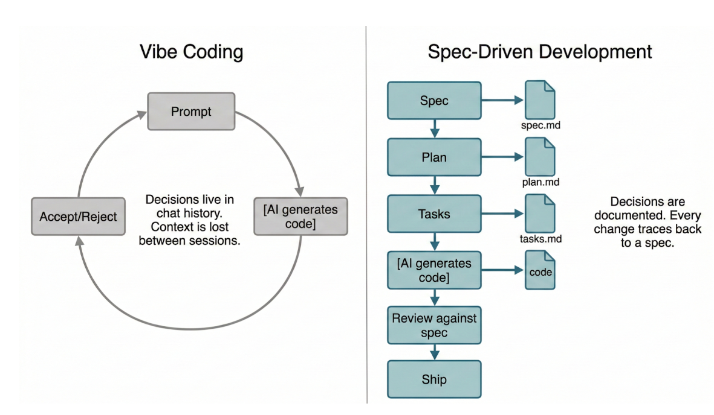

Spec-Driven Development (SDD) adds structure to this loop. Before any code is generated, you write a specification: what the feature does, who it serves, what the success criteria are. The AI assistant works from that spec — and so do you when reviewing its output. The spec becomes the single source of truth for intent. If the code diverges from the spec, you catch it in review. If requirements change, you update the spec first, then regenerate. Decisions are documented, not improvised.

The tradeoff is real: SDD is slower per feature than vibe coding. You write documents before writing code. But the payoff compounds — every future change to the codebase has context, every AI-generated implementation has a reviewable contract, and you can onboard collaborators (human or AI) by pointing them at specs instead of explaining decisions from memory.

Antigravity already follows spec-driven development principles. When you set the agent to **Planning mode**, it produces two artifacts before writing any code:

- **Implementation Plan** — an overview of the proposed technical approach, file changes, and architecture decisions

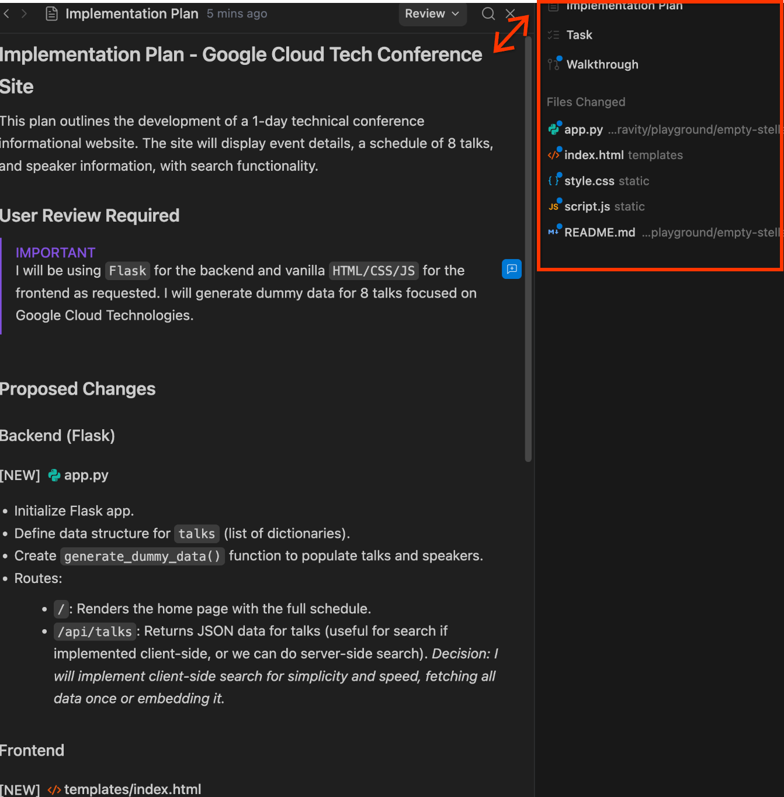
- **Task List** — a structured breakdown of work items

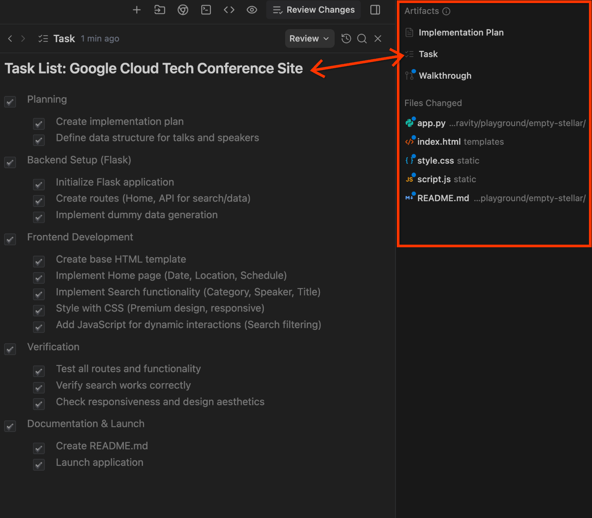

Antigravity asks you to review and approve these artifacts before execution. This plan-then-implement loop is the core of spec-driven development: specifications guide the code, not the other way around.

This codelab takes that foundation further with an ***opinionated***, version-controlled workflow based on  [**spec-kit**](https://github.com/github/spec-kit) — a specification-driven development framework from GitHub. Every feature goes through a deliberate pipeline where each artifact is a standalone document you can review, edit, and track in `git`. The pipeline includes two optional quality-gate phases (clarify and analyze) that catch issues before they become implementation problems:


| Phase | Artifact | Purpose |
| --- | --- | --- |
| /speckit.specify | spec.md | Define WHAT to build (user-facing, technology-agnostic) |
| /speckit.clarify (optional) | Updated spec.md | Identify underspecified areas, ask targeted clarification questions, encode answers back into the spec |
| /speckit.plan | plan.md, data-model.md, research.md | Design HOW to build it (technical approach, data models, research) |
| /speckit.tasks | tasks.md | Break the plan into ordered, actionable steps |
| /speckit.analyze (optional) | Analysis report | Review tasks for risks, gaps, or missing edge cases before implementation |
| /speckit.implement | Code changes | Execute the tasks, checking off each one |


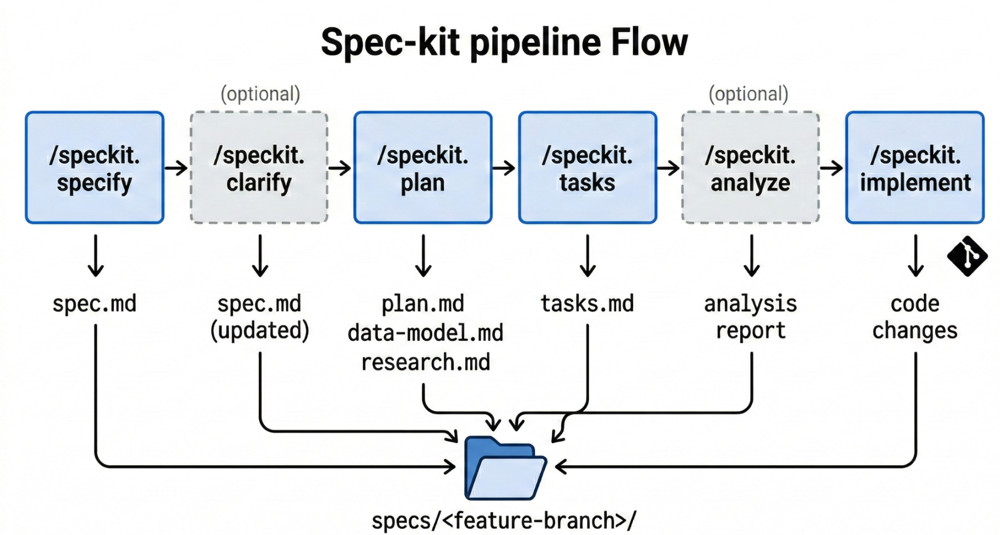

Every artifact is persisted as a file in `specs/<feature-branch>/`, version-controlled in git, and reusable. If a conversation is interrupted or you want to revisit decisions later, the specification documents are always there — not buried in a chat history.

> [!NOTE]
> **Notes:** Antigravity built-in artifact has superiority in the UI which enables user comment on the generated artifact ( even image! ). Hence in this tutorial we modify the original `spec-kit` prompt to integrate with built-in artifact in `implement` phases

The starter repo includes these SDD workflows in `.agents/workflows/` and templates in `.specify/templates/`. You will use them later on to add features to the agent.

---

## 4. Bootstrap Project Context with Antigravity

Now, let&#39;s simulate things with a condition that &#34;kinda closer&#34; to our everyday job:

- Not well managed repository
- README obsolete
- Documentations not frequently updated

> [!NOTE]
> **Note:** Consider yourself very lucky if this is not reflecting your condition

The first thing we want to do in this kind of situation is usually creating a map or context about the project that we want Antigravity to work on. This step shows one example of an approach on how to give Antigravity deep understanding of an existing codebase by creating a skill that analyzes the repository and generates a project context document.

It also sets up the project constitution — the non-negotiable principles that the SDD workflows validate against. Together, these give Antigravity the context and constraints it needs for the SDD cycles later on

### The Antigravity context hierarchy

Antigravity uses three levels of context, each with a different scope:

- **Rules** (`.agents/rules/`): Always-active instructions. Every conversation in this workspace sees them ( if you activated it ). Use rules for project-wide context like architecture decisions, coding standards, or technology stack information.
- **Skills** (`.agents/skills/`): On-demand knowledge. Antigravity loads a skill only when the current task matches the skill's `description` field. Use skills for domain-specific reference material.
- **Workflows** (`.agents/workflows/`): Saved prompts triggered with `/` commands. Use workflows for repeatable multi-step processes like the SDD pipeline.

> [!NOTE]
> **Note:** The project currently has workflows (SDD pipeline) and 2 skills (**repo-research** and **mcp-toolbox-postgres** ) but no rules. Later, we will create a `project-context.md` rule that gives Antigravity persistent understanding of the codebase — what technologies are in use, how files are organized, what has been built so far.

### Activate the skills

The starter repo includes two pre-written skills in `.agents/skills/`. They contain detailed instructions but start with `TODO(codelab)` comments instead of the required YAML frontmatter. Without frontmatter, Antigravity cannot discover them.

Antigravity skills require a YAML frontmatter block at the top of the file with two fields:

- **`name`** — a unique identifier for the skill
- **`description`** — a natural language summary that Antigravity matches against when deciding which skill to load for a given request

**Open .agents/skills/mcp-toolbox-postgres/SKILL.md in the editor**. Replace the `TODO(codelab)` comment lines at the top with this frontmatter:

```yaml
---
name: mcp-toolbox-postgres
description: Configure MCP Toolbox for PostgreSQL — sources, tools, and embedding models
---
```

> [!NOTE]
> **Notes:** The MCP Toolbox Postgres skill contains the proper configuration for `sources`, `tools` and `embedding models`

**Open .agents/skills/repo-research/SKILL.md in the editor**. Replace the `TODO(codelab)` comment lines at the top with this frontmatter:

```yaml
---
name: repo-research
description: Analyze a repository's structure, technologies, and patterns to create or update a project context document. Use when asked to research, analyze, or understand a codebase.
---
```

> [!NOTE]
> **Notes:** Read the `repo-research` SKILL.md in detail. This is one example prompt to analyze your repository, note that the incremental update rules are intentionally conservative. If Antigravity's context runs out mid-research or the conversation is interrupted, everything discovered so far is already saved to the file. Re-invoking the skill picks up where it left off without losing progress.

> [!WARNING]
> **Warning!** Analyzing a big repository can exhaust your quota quickly!

Verify both skills have valid frontmatter:

```bash
head -4 .agents/skills/mcp-toolbox-postgres/SKILL.md
head -4 .agents/skills/repo-research/SKILL.md
```

Each should show `---` delimiters wrapping `name:` and `description:` fields. If the delimiters or fields are missing, Antigravity will not recognize the skill.

Both skills are loaded on-demand — Antigravity matches your request against the `description` field and pulls in the full instructions only when relevant.

### Configure ADK Docs MCP

In order to ensure our coding agent has correct knowledge of how to develop our ADK agent, it will need proper access to ADK documentation. We can enable this by setting up the  [ADK docs MCP server](https://adk.dev/tutorials/coding-with-ai/#adk-docs-mcp-server) .

First, from the Antigravity editor, find the &#34;ellipsis&#34; icon on the top-right agent window and click it, you will see configuration options for the MCP and customization like this. Click the MCP one.

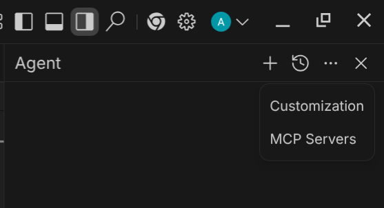

Next, click the `Manage MCP servers` button

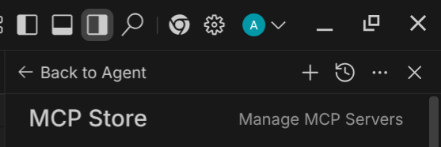

It will open the MCP servers configurations tab, then click the `View Raw Config` button

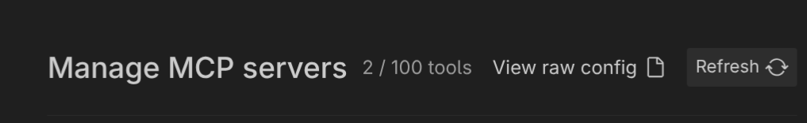

It will open the `mcp_config.json` file. Now copy paste this configuration to the file

```json
{
    "mcpServers": {
        "adk-docs-mcp": {
            "command": "uvx",
            "args": [
                "--from",
                "mcpdoc",
                "mcpdoc",
                "--urls",
                "AgentDevelopmentKit:https://adk.dev/llms.txt",
                "--transport",
                "stdio"
            ]
        }
    }
}
```

> [!NOTE]
> **Note:** Don't forget to save the changes!

This setup will enable the coding agent to search and read ADK documentation using an MCP server

### Install Publicly Available Skills

We previously inspected skills that we created on our own ( the `repo-research` and `mcp-toolbox-postgres` skills). However there are many other skills that are useful to support our software development and can be easily installed to our coding agent.

#### Caveman Skills

One of the useful skills to reduce token usage is this  [caveman skill](https://github.com/juliusbrussee/caveman) . This skill can cut the output token from the agent,make it a good combination when you utilize a full Spec-driven development like this tutorial

```bash
npx skills add JuliusBrussee/caveman
```

Similar like before, let&#39;s select the `caveman` skill here for now

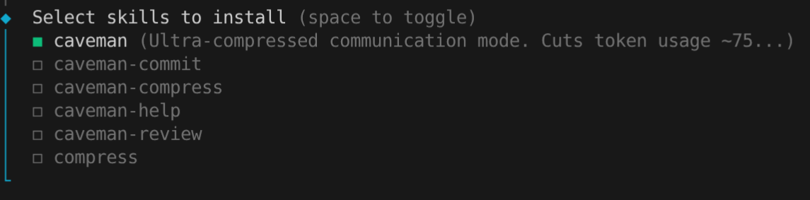

Then, just click **Enter** to other option to enable default installation and installing the skill in your current project

Now, we should already have 4 skills configured and ready to start our SDD journey

```text
.agents/skills/
├── caveman
├── mcp-toolbox-postgres
└── repo-research
```

### Generate the project context

Ensure the rules directory exists:

```bash
mkdir -p .agents/rules
```

In Antigravity&#39;s Agent Manager/Chat box (in editor mode press `ctrl + L`), start a new conversation. Type:

```text
Research this repository and create a project context document, and communicate efficiently
```

Antigravity matches your request to the `repo-research` and `caveman` skill ( command to communicate efficiently ), and begins systematically analyzing the codebase. It reads configuration files, source code, and documentation, then populates the project context template with its findings.

Once complete, open `.agents/rules/project-context.md` in the editor. It contains concrete information about the project: technology stack (Python 3.12, ADK, MCP Toolbox, Cloud SQL), project structure, data model (menu_items table with `pgvector`), and external integrations.

> [!NOTE]
> **Tip:** The project context document grows as the project evolves. You can re-run the skill to update the context with the new additions. The incremental update rules ensure existing content is preserved — new technologies, entities, and integrations are appended, not overwritten.
> For targeted updates, use specific prompts: "Research the database schema and update the project context" or "Update the project context with the new tool definitions." Each invocation adds to the existing document.

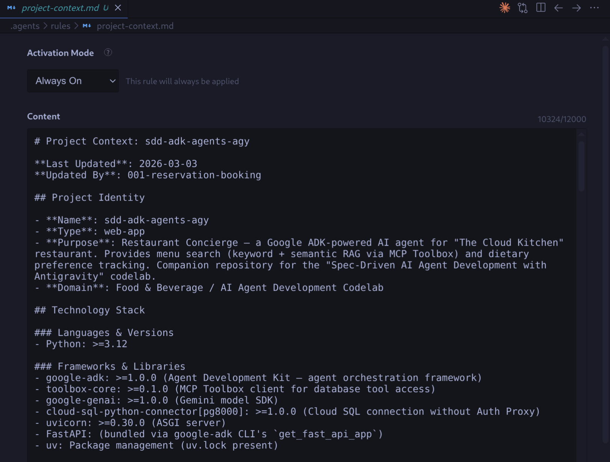

### Set the project constitution

The SDD workflows reference a project constitution at `.specify/memory/constitution.md` during planning and analysis. The `/speckit.plan` workflow runs a &#34;Constitution Check&#34; against it, and `/speckit.analyze` flags violations as CRITICAL. If the constitution is left as a blank template with placeholder tokens, these checks have nothing to validate against — plans and analyses run without guardrails.

The constitution defines non-negotiable project principles. This is a small repo maintained by a single developer, so the constitution should reflect that scope — keep things simple, consistent, and avoid over-engineering.

In Antigravity&#39;s Agent Manager, start a new conversation. Run the constitution workflow:

```text
/speckit.constitution This is a small restaurant concierge ADK agent maintained by one developer. Set 3 principles: (1) All database operations go through MCP Toolbox tool definitions in tools.yaml — no raw SQL in Python code, no ORM. (2) Session state uses ADK ToolContext — no custom state management, no external state stores. (3) Keep it simple — follow existing file and naming conventions exactly.
```

Antigravity fills the constitution template with concrete principles, assigns a version (1.0.0), and runs a consistency check across the SDD templates.

Review the generated constitution at `.specify/memory/constitution.md`. Verify the three principles are present and clearly stated.

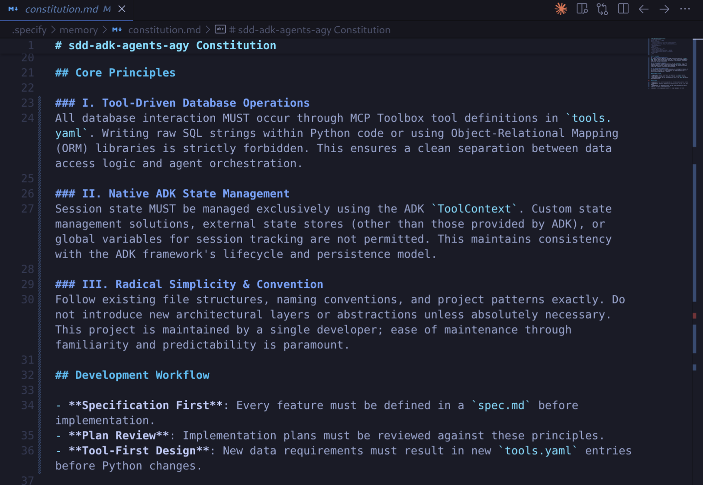

> [!NOTE]
> **Note:** The constitution is deliberately kept to 3 principles scoped for a solo developer. The `/speckit.constitution` workflow supports incremental amendments — run it again with additional principles and it handles versioning automatically. For a team project, you would add principles for code review, testing discipline, observability, and API versioning.

> [!NOTE]
> **Checkpoint: **`.agents/rules/project-context.md` exists with concrete information about the repository. `.agents/skills/repo-research/SKILL.md` demonstrates skill creation with YAML frontmatter, instructions, and conflict resolution. `.specify/memory/constitution.md` contains three project principles that the plan and analyze workflows validate against. You understand the three-level context hierarchy: rules (always-active), skills (on-demand), workflows (slash commands).

---

## 5. SDD Cycle — Add Reservation Feature

This step walks through a complete SDD cycle to add reservation booking to the restaurant concierge agent. You drive Antigravity through each phase — specify, clarify, plan, tasks, analyze, implement — observing how each artifact builds on the previous one. This is the core learning experience of the codelab.

> [!WARNING]
> **Important!** Antigravity is an AI assistant — its generated artifacts (specs, plans, tasks, code) may differ from what this tutorial describes. The file names, exact SQL schemas, and code structure may vary. This is expected and part of working with AI-assisted development. The SDD workflow ensures you review every artifact before it becomes code, so use your judgment to accept, modify, or regenerate any output that does not match your expectations.

### Specify the feature

In Antigravity&#39;s Agent Manager, start a new conversation. Type the `/speckit.specify` workflow command with a feature description:

```text
/speckit.specify Add reservation booking capability to the restaurant concierge agent. Guests should be able to make a table reservation by providing their name, party size, date, and time. They should also be able to check existing reservations. The agent should confirm reservation details before booking and handle special requests (e.g., "window seat", "birthday celebration").
```

Antigravity creates a feature branch, generates a specification document, and runs quality validation. If Antigravity presents clarification questions, answer them based on the feature description above.

> [!NOTE]
> **Note:** After completing the specification, Antigravity may present handoffs such as **"Build Technical Plan"** or **"Clarify Spec Requirements"**. These are cue to the next workflow phase (`/speckit.plan` or `/speckit.clarify`)

The specification focuses on WHAT and WHY — not HOW. It describes the user experience (&#34;Guests can book a reservation by providing their name, party size, date, and time&#34;) without mentioning SQL tables, `tools.yaml`, or ADK APIs. Implementation details come in the planning phase.

Review the generated specification at `specs/<branch-name>/spec.md`. Verify it captures the functional requirements and success criteria.

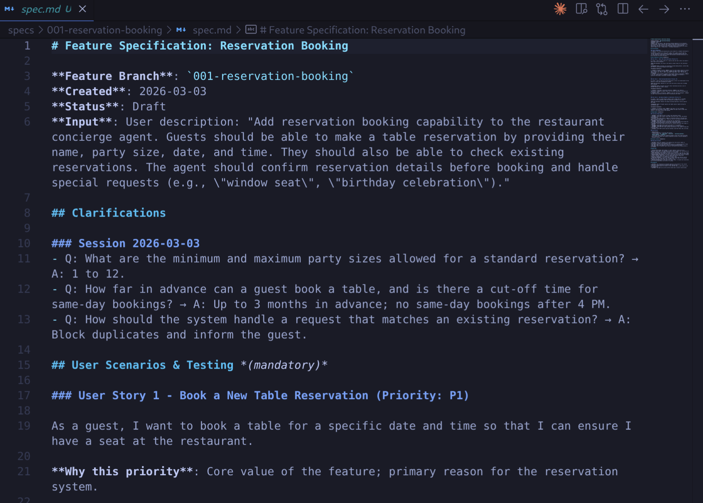

### Clarify the specification (optional)

Run the clarify workflow to identify and resolve underspecified areas in the spec:

```text
/speckit.clarify
```

Antigravity scans the spec for ambiguities, missing acceptance criteria, and underspecified requirements. It asks targeted clarification questions — each answerable with a short selection or phrase. Your answers are encoded directly back into the spec, making it more precise before planning begins.

> [!NOTE]
> **Tip:** The clarify step is optional but recommended for complex features. For straightforward specs, skip directly to planning.

### Plan the implementation

Run the planning workflow:

```text
/speckit.plan Update the restaurant concierge agent to multi agent architecture which separate responsibilities for handling menu and reservations. Utilize your access to ADK Docs tools and MCP toolbox skill to implement it properly
```

Antigravity generates a technical plan through two phases:

1. **Research phase** — resolves unknowns about the existing codebase, generates `research.md`
2. **Design phase** — creates `data-model.md` (reservations entity definition) and updates `project-context.md`

Antigravity should use the ADK Docs MCP tools and MCP toolbox docs skill during planning. Review the key artifacts:

- `specs/<branch-name>/plan.md` — the technical approach: which files to modify, what patterns to follow
- `specs/<branch-name>/data-model.md` — the reservations entity definition (columns, types, relationships)
- `specs/<branch-name>/research.md` — decisions made and rationale

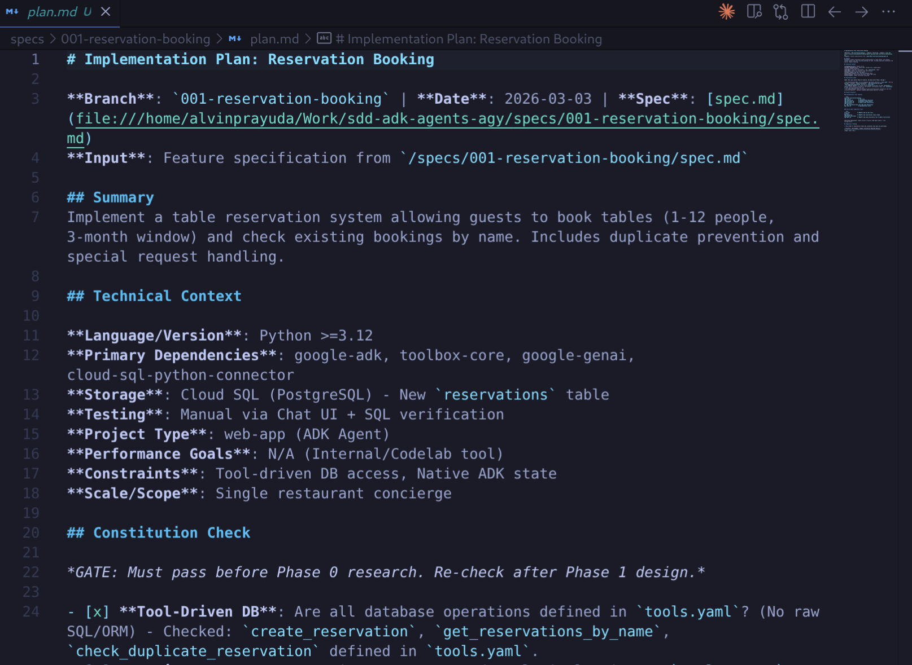

### Generate tasks

Run the tasks workflow

```text
/speckit.tasks
```

Antigravity breaks the plan into an ordered task list in `specs/<branch-name>/tasks.md`. Tasks follow a strict checklist format with IDs, priority markers, and file paths, for example:

```text
- [ ] [T001] [P] Create reservations table schema in scripts/seed_db.py
- [ ] [T002] [P] Add create_reservation tool to tools.yaml
- [ ] [T003] [P] Add list_reservations tool to tools.yaml
- [ ] [T004] [P] Update agent instruction in restaurant_concierge/agent.py
```

Tasks are organized into phases: Setup → Foundational → User Stories → Polish. Scan the task list to understand what will be created and modified.

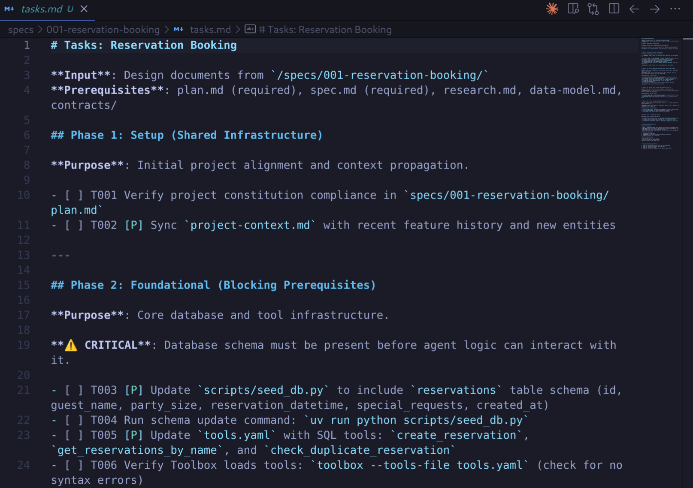

### Analyze tasks (optional)

Run the analyze workflow to review the tasks for risks and gaps:

```text
/speckit.analyze
```

Antigravity checks the task list against the spec and plan, looking for missing edge cases, tasks that may conflict, or gaps between the spec&#39;s requirements and the planned work. Address critical issues before implementing.

> [!NOTE]
> **Tip:** The analyze step is most useful when the task list is long or the feature touches multiple subsystems. For a focused feature like reservation booking, a quick scan is sufficient.

---

## 6. Implement

Run the implementation workflow:

```text
/speckit.implement
```

Antigravity presents a final implementation plan and task artifact. Review and approve it to proceed

> [!NOTE]
> **Tip:** You can comment on it directly! This can only be done with Antigravity built-in Artifact

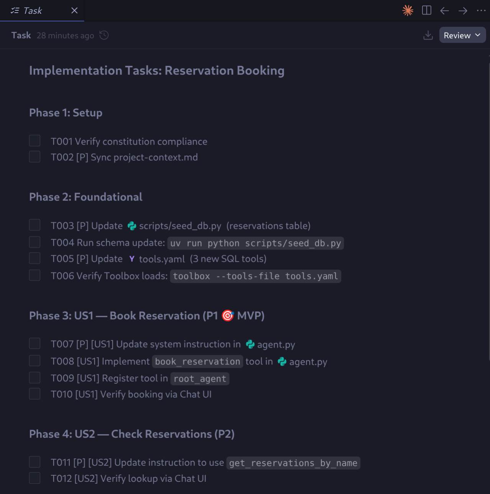

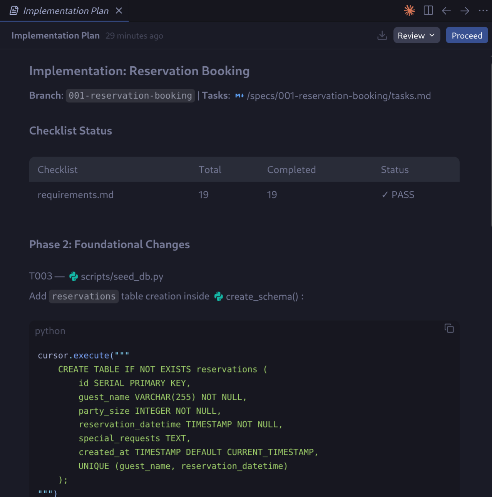

Antigravity executes the tasks, checking each one off as it completes. When it finished, it will present the complete Walkthrough

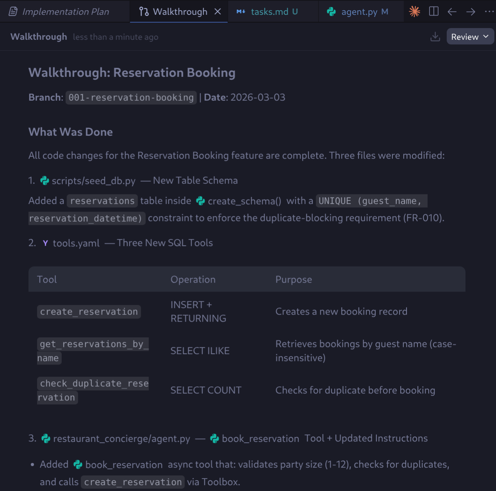

### Test the code changes

After implementation completes, verify the key changes were made. The exact file names and content may vary, but these patterns should be present like in `tools.yaml` and `agent.py`:

```bash
# Verify reservation tools were added to tools.yaml
grep -i "reservation" tools.yaml
```

You will see some output like this

```text
...
get_reservations_by_name:
      Retrieve all reservations for a guest by their name. Uses case-insensitive
      SELECT id, guest_name, party_size, reservation_datetime, special_requests, created_at
      FROM reservations
      ORDER BY reservation_datetime DESC
...
```

And for `agent.py`

```bash
# Verify agent instruction was updated
grep -i "reservation" restaurant_concierge/agent.py

# Check what files changed
git diff --name-only
```

Maybe you will find changes like this

```text
...
- **Table Reservations**: Help guests book a table or check their existing reservations.
## Reservation Booking Rules
When a guest wants to make a reservation, collect ALL of the following before confirming:
**IMPORTANT**: Before calling `book_reservation`, you MUST:
- Only call `book_reservation` after the guest says "yes" or "confirm"
## Checking Reservations
When a guest asks to check their reservations:
- Use `get_reservations_by_name` to find their bookings
        book_reservation,
...
```

> [!NOTE]
> **Note:** If `grep` returns no matches for either file, the implementation may have used different naming. Check `git diff` to see the full set of changes and verify reservation-related logic was added.

The changes should be affecting the seed database script. The updated script should create the `reservations` table if it does not already exist. You should see output confirming the new table was created (the existing `menu_items` data is preserved).

> [!NOTE]
> **Note:** Antigravity may have created a separate migration script (e.g., `scripts/create_reservations.py`) instead of updating `seed_db.py`. Check `git diff --name-only` for any new scripts in `scripts/` and run those instead.

If everything goes well up to this point, we can test the feature on the ADK agent Dev UI. Let&#39;s do the database migration to incorporate new table and restart the Toolbox to pick up the new tool definitions in `tools.yaml`. Stop any existing Toolbox process, then start a fresh one:

```bash
lsof -ti:5000 | xargs kill -9 2>/dev/null; echo "Done"
./scripts/setup_database.sh > database_setup.log 2>&1 &
```

You can check the output log in the `database_setup.log` whether Antigravity generates correct code and configuration or not. If you encounter error try interacting with the agent to fix it

If all goes well, then we can start the ADK dev UI:

```bash
uv run adk web .
```

Open `http://localhost:8000` in your browser and test with these prompts:

```text
I'd like to book a table for 4 people on Friday at 7pm under the name Timmy
```

> [!NOTE]
> **Inspect:** the agent should confirm the reservation details and create it

```text
Do I have any upcoming reservations?
```

> [!NOTE]
> **Inspect:** the agent should list the reservation you just made

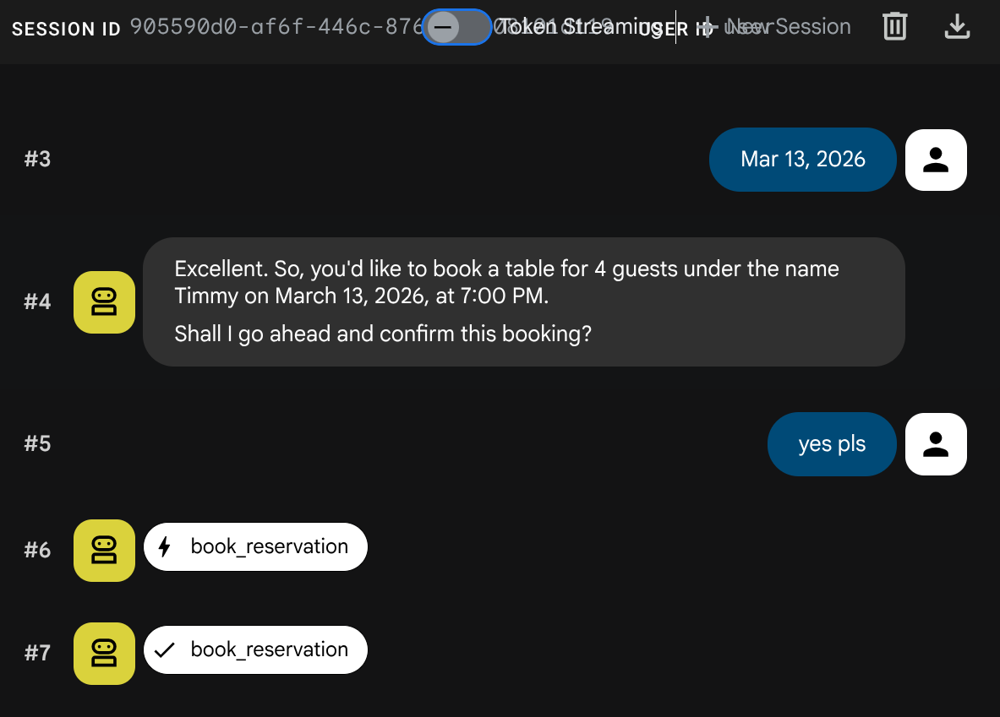

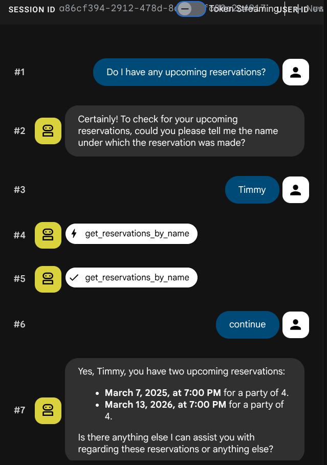

Now, stop the ADK dev UI with `Ctrl+C` twice.

> [!NOTE]
> **Checkpoint:** The agent handles reservation booking and lookup. You have completed a full SDD cycle: specify → clarify → plan → tasks → analyze → implement → test. Each phase produced a versioned artifact in `specs/<branch-name>/`.

---

## 7. Challenges (Optional)

You now know the full SDD workflow. Put it to the test:

- Run a second SDD cycle to build a web chat interface for the restaurant concierge — this time without step-by-step guidance.
- Deploy your agent to Cloud Run for production scenario

### Hints

- The project has no frontend framework. Antigravity should propose vanilla HTML/CSS/JS — if it suggests React or similar, nudge it toward simplicity (your constitution's "keep it simple" principle should catch this).
- The ADK server exposes `/run_sse` for streaming and `/apps/{app_name}/users/{user_id}/sessions` for session management. Antigravity discovers these from the project context.
- After implementation, start the server with `uv run uvicorn server:app --host 0.0.0.0 --port 8080` (not `adk web`) so the static file mount works.
- Test at  [`http://localhost:8080/static/index.html`](http://localhost:8080/static/index.html).
- The reference codelabs already show how to deploy and persist ADK agent, give Antigravity references to this!

---

## 8. Congratulations!

You have extended a restaurant concierge ADK agent with reservation booking — entirely through Antigravity&#39;s SDD workflows, without writing application code by hand.

### What you built

- A restaurant concierge ADK agent with menu search, semantic search, dietary preference tracking, and reservation booking
- An Antigravity skill for repo research that generates and maintains a project context document
- A project constitution that enforces non-negotiable principles during planning and analysis
- A complete SDD cycle demonstrating the specify → clarify → plan → tasks → analyze → implement workflow

### What you learned

- How to use Spec-Driven Development workflows in Antigravity to systematically add features to an existing codebase
- How to create Antigravity skills and configure MCP that package domain knowledge for reuse across conversations
- How to bootstrap project context so Antigravity makes informed decisions about architecture, patterns, and technology choices
- How to set a project constitution that the SDD workflows validate against
- How to extend an ADK agent with new database-backed tools via MCP Toolbox

### Clean up

Stop any running local processes (Toolbox):

```bash
lsof -ti:5000 | xargs kill -9 2>/dev/null
```

Delete the Cloud SQL instance to avoid ongoing charges:

```bash
gcloud sql instances delete restaurant-db --quiet
```

Optionally, delete the entire project:

```bash
gcloud projects delete $GOOGLE_CLOUD_PROJECT
```

> [!WARNING]
> **Important:** You can undo this delete operation for a limited period of time by using this command `gcloud projects undelete ${GOOGLE_CLOUD_PROJECT}`
